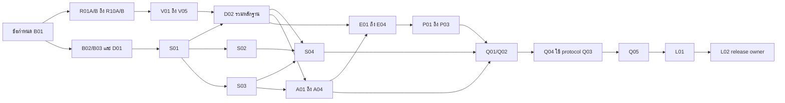

# แผนส่งต่อ Study Abroad OS: China 10
จัดทำ 2026-09-22 จาก baseline 630a2b1. สถานะ: PLAN READY; implementation tasks ยังไม่เริ่ม.
อ่านเริ่มต้น: [สถานะจริง](CURRENT-STATE.md), [กติกา Agent](RULES.md), [Prompt ย้ายแชท](NEW-CHAT-PROMPT.md).
แผนนี้มี **52 ใบงาน** แยก research/coding/testing/review/deployment. ไม่มีงานสร้าง MVP ของเดิมซ้ำ.

## ส่วนที่ 1: ภาพรวมระบบปัจจุบัน
รายละเอียดและหลักฐานใน CURRENT-STATE.md. Git local/remote ตรงกัน; public API คืน 10 records/10 universities และทั้งหมด partial ณ checkedAt 2026-09-16; test เดิมผ่าน 5/5.
ระบบ source เดิมเก็บ snapshot และตรวจ hash แบบรายวัน. ยังไม่ทำ extraction/normalization/review/publication อัตโนมัติ.
รายงาน 'MVP เสร็จ' ในแชทเดิมหมายถึงฟังก์ชันพื้นฐาน; ไม่ใช่ข้อมูลครบทุกหลักสูตรหรือ verified ทั้งหมด.
เป้าหมายรอบนี้: ข้อมูลสิบเส้นทางมี field evidence และการตรวจรับ; ผู้ดูแลนำข้อมูลเปลี่ยนขึ้นเผยแพร่ได้; eligibility และแผนสมัครใช้ข้อเท็จจริง/ปีที่ถูกต้อง; ผ่าน usability จริง.
ไม่เพิ่มประเทศ/มหาวิทยาลัย, ไม่สร้าง auth ใหม่, ไม่เปลี่ยน pg เป็น Prisma, ไม่เพิ่ม AI extraction provider, file upload, email provider หรือ Agent integration โดยอัตโนมัติ.
เอกสาร DATA-CONTRACT เป็นข้อเสนอ; B01 freeze semantics ก่อน worker เขียน schema.

## ส่วนที่ 2: รายการงานทั้งหมดตามลำดับ
ทุก task status เริ่ม PLANNED. B01 เป็นงานแรก; ลำดับจริงยึด dependency ในตารางและ TASKS.json ไม่ยึดเลขหรือลำดับแถว.
P0 = correctness/data integrity/release gate, P1 = committed product work; priority ไม่ข้าม dependency.
ประมาณการเป็นเล็ก/กลาง ไม่มีประมาณชั่วโมงหรือสัญญา token savings.

| ID | งาน | ประเภท | ต้องรอ | ระดับ | ขนาด |
|---|---|---|---|---|---|
| [B01](tasks/B01.md) | ล็อกข้อกำหนดข้อมูลและขอบเขตรอบส่งมอบ | planning | ไม่มี | P0 | กลาง |
| [B02](tasks/B02.md) | เตรียม test harness บนฐานข้อมูลทิ้งได้ | testing | B01 | P0 | กลาง |
| [B03](tasks/B03.md) | แยก seed ออกจาก build และป้องกันทับข้อมูลที่ตรวจแล้ว | coding | B02 | P0 | กลาง |
| [R01A](tasks/R01A.md) | ตรวจการรับสมัคร: Peking University | research | B01 | P0 | กลาง |
| [R01B](tasks/R01B.md) | ตรวจทุน: Peking University | research | B01 | P0 | เล็ก |
| [R02A](tasks/R02A.md) | ตรวจการรับสมัคร: Fudan University | research | B01 | P0 | กลาง |
| [R02B](tasks/R02B.md) | ตรวจทุน: Fudan University | research | B01 | P0 | เล็ก |
| [R03A](tasks/R03A.md) | ตรวจการรับสมัคร: Shanghai Jiao Tong University | research | B01 | P0 | กลาง |
| [R03B](tasks/R03B.md) | ตรวจทุน: Shanghai Jiao Tong University | research | B01 | P0 | เล็ก |
| [R04A](tasks/R04A.md) | ตรวจการรับสมัคร: Zhejiang University | research | B01 | P0 | กลาง |
| [R04B](tasks/R04B.md) | ตรวจทุน: Zhejiang University | research | B01 | P0 | เล็ก |
| [R05A](tasks/R05A.md) | ตรวจการรับสมัคร: Xiamen University | research | B01 | P0 | กลาง |
| [R05B](tasks/R05B.md) | ตรวจทุน: Xiamen University | research | B01 | P0 | เล็ก |
| [R06A](tasks/R06A.md) | ตรวจการรับสมัคร: Tongji University | research | B01 | P0 | กลาง |
| [R06B](tasks/R06B.md) | ตรวจทุน: Tongji University | research | B01 | P0 | เล็ก |
| [R07A](tasks/R07A.md) | ตรวจการรับสมัคร: East China Normal University | research | B01 | P0 | กลาง |
| [R07B](tasks/R07B.md) | ตรวจทุน: East China Normal University | research | B01 | P0 | เล็ก |
| [R08A](tasks/R08A.md) | ตรวจการรับสมัคร: Beijing Language and Culture University | research | B01 | P0 | กลาง |
| [R08B](tasks/R08B.md) | ตรวจทุน: Beijing Language and Culture University | research | B01 | P0 | เล็ก |
| [R09A](tasks/R09A.md) | ตรวจการรับสมัคร: University of International Business and Economics | research | B01 | P0 | กลาง |
| [R09B](tasks/R09B.md) | ตรวจทุน: University of International Business and Economics | research | B01 | P0 | เล็ก |
| [R10A](tasks/R10A.md) | ตรวจการรับสมัคร: Shandong University of Finance and Economics | research | B01 | P0 | กลาง |
| [R10B](tasks/R10B.md) | ตรวจทุน: Shandong University of Finance and Economics | research | B01 | P0 | เล็ก |
| [V01](tasks/V01.md) | ตรวจทานหลักฐานคู่ pku + fudan | review | R01A, R01B, R02A, R02B | P0 | กลาง |
| [V02](tasks/V02.md) | ตรวจทานหลักฐานคู่ sjtu + zju | review | R03A, R03B, R04A, R04B | P0 | กลาง |
| [V03](tasks/V03.md) | ตรวจทานหลักฐานคู่ xmu + tongji | review | R05A, R05B, R06A, R06B | P0 | กลาง |
| [V04](tasks/V04.md) | ตรวจทานหลักฐานคู่ ecnu + blcu | review | R07A, R07B, R08A, R08B | P0 | กลาง |
| [V05](tasks/V05.md) | ตรวจทานหลักฐานคู่ uibe + sdufe | review | R09A, R09B, R10A, R10B | P0 | กลาง |
| [D01](tasks/D01.md) | เพิ่ม provenance และรอบสมัครแบบเข้ากับข้อมูลเดิม | coding | B01, B02 | P0 | กลาง |
| [S01](tasks/S01.md) | ทำ source ID ให้คงที่และรักษาประวัติ | coding | B03 | P0 | กลาง |
| [D02](tasks/D02.md) | รวมข้อมูลที่ผ่าน review เข้า catalog ชุดแรก | coding | D01, S01, V01, V02, V03, V04, V05 | P0 | กลาง |
| [S02](tasks/S02.md) | จำกัดการดาวน์โหลดและแยก error ของแต่ละแหล่ง | coding | S01, B02 | P1 | กลาง |
| [S03](tasks/S03.md) | เพิ่มตารางคิวตรวจทานและสถานะรัน | coding | D01, S01, B02 | P1 | กลาง |
| [S04](tasks/S04.md) | เชื่อมการตรวจรายวันกับคิวแบบไม่เผยแพร่อัตโนมัติ | coding | S02, S03, D02 | P1 | กลาง |
| [A01](tasks/A01.md) | ทำ API อ่านคิวและ snapshot สำหรับผู้ดูแล | coding | S03 | P1 | กลาง |
| [A02](tasks/A02.md) | ทำ API เตรียม draft จากหลักฐานที่ตรวจแล้ว | coding | A01, D02 | P1 | กลาง |
| [A03](tasks/A03.md) | ทำ atomic publish และปิดช่อง bypass ของ admin เดิม | coding | A02, B03 | P0 | กลาง |
| [A04](tasks/A04.md) | เพิ่มหน้าคิวผู้ดูแลและก่อนหลังการแก้ข้อมูล | coding | A03, S04 | P1 | กลาง |
| [E01](tasks/E01.md) | แก้การเทียบปีและอายุผลสอบให้มีขอบเขตชัด | coding | D02 | P1 | กลาง |
| [E02](tasks/E02.md) | ผูกภาษาและวุฒิกับกฎที่มีหลักฐาน | coding | E01 | P1 | กลาง |
| [E03](tasks/E03.md) | เพิ่มรายละเอียด CSCA ตามกฎโปรแกรม | coding | E02 | P1 | กลาง |
| [E04](tasks/E04.md) | แสดงผล eligibility และ freshness ที่ตรงกับหลักฐาน | coding | E03, A04 | P1 | กลาง |
| [P01](tasks/P01.md) | แก้ปีเป้าหมายและการอัปเดตสถานะใบสมัคร | coding | A03, E03 | P1 | กลาง |
| [P02](tasks/P02.md) | ป้องกันการบันทึกทับกันของแผนสมัคร | coding | P01 | P1 | กลาง |
| [P03](tasks/P03.md) | เพิ่มสถานะใบสมัครและบันทึก notes อย่างทนต่อความผิดพลาด | coding | P02, E04 | P1 | กลาง |
| [Q01](tasks/Q01.md) | ตรวจสิทธิ์และ flow ข้อมูลร่วมกันใน integration suite | testing | S04, A03, E03, P02 | P0 | กลาง |
| [Q02](tasks/Q02.md) | ทดสอบเส้นทางนักเรียนและผู้ดูแลบน browser | testing | Q01, A04, E04, P03 | P0 | กลาง |
| [Q03](tasks/Q03.md) | จัดสคริปต์ usability test สำหรับนักเรียนไทย | planning | B01 | P1 | กลาง |
| [Q04](tasks/Q04.md) | ดำเนิน usability test กับผู้ทดลองจริงห้าคน | usability | Q02, Q03 | P1 | กลาง |
| [Q05](tasks/Q05.md) | ตรวจรับ candidate แบบอิสระ | review | Q04 | P0 | กลาง |
| [L01](tasks/L01.md) | เตรียม runbook และ rehearsal ก่อน deploy | deployment-preparation | Q05, B03 | P0 | กลาง |
| [L02](tasks/L02.md) | ปล่อย candidate และตรวจข้อมูลจริงโดย release owner | deployment | L01 | P0 | กลาง |

## ส่วนที่ 3: Dependency Graph
กราฟละเอียดครบทุก ID อยู่ใน [DEPENDENCIES.mmd](DEPENDENCIES.mmd); machine-readable graph อยู่ใน [TASKS.json](TASKS.json).

ภาพนี้ย่อเพื่ออ่านง่าย; edges ราย task ใน .mmd/TASKS.json เป็นลำดับใช้งานจริง.

## ส่วนที่ 4: งานที่ทำพร้อมกันได้
ด้านล่างเป็น safe waves แบบรอรอบก่อนครบเพื่อความง่าย. Coordinator ที่พร้อมสามารถเริ่ม task ทันทีที่ deps ของตัวเอง ACCEPTED โดยไม่ต้องรอทั้ง wave.
1. Wave 1: B01
2. Wave 2: B02, R01A, R01B, R02A, R02B, R03A, R03B, R04A, R04B, R05A, R05B, R06A, R06B, R07A, R07B, R08A, R08B, R09A, R09B, R10A, R10B, Q03
3. Wave 3: B03, V01, V02, V03, V04, V05, D01
4. Wave 4: S01
5. Wave 5: D02, S02, S03
6. Wave 6: S04, A01, E01
7. Wave 7: A02, E02
8. Wave 8: A03, E03
9. Wave 9: A04, P01
10. Wave 10: E04, P02
11. Wave 11: P03, Q01
12. Wave 12: Q02
13. Wave 13: Q04
14. Wave 14: Q05
15. Wave 15: L01
16. Wave 16: L02

แนะนำเริ่ม worker research 2-3 ตัว ไม่เปิด 20 ตัวทันที; ตัวเลขนี้เป็นค่าเริ่มเชิงปฏิบัติ ไม่ใช่ performance guarantee.
RxxA/B เขียนคนละไฟล์ จึงขนานได้. Vxx ใช้ reviewer แยกจากผู้วิจัย.
Shared files ต้องมี owner ทีละงาน: package.json(B02->B03->Q02), catalog.ts(S01->D02), domain.ts(D01->E01->E02->E03->P01->P02), workspace route(A03->P01->P02), page.tsx(A04->E04->P03).
การทำ worktree แยกไม่ทำให้ dependent contracts ใช้ร่วมกันได้ทันที; merge accepted output ก่อนเริ่ม consumer.
Agent ไม่แก้ TASKS.json เอง. Coordinator บันทึก READY/IN_PROGRESS/READY_FOR_REVIEW/ACCEPTED/BLOCKED โดยอ้าง commit/artifact.

## ส่วนที่ 5: แผนตรวจรับก่อน Deploy
1. Evidence gate: V01-V05 ครบ; critical facts ที่จะแสดงเป็น verified ทุกค่ามีหลักฐานตรงโปรแกรม/ปี; unknown แสดงตามจริง.
2. Data gate: B03/S01 migration+seed replay ผ่านบน DB ทิ้งได้; ไม่สลับ history และไม่ทับข้อมูลที่ admin แก้.
3. Workflow gate: S04/A03 source change สร้าง queue, non-admin publish ไม่ได้, approve เป็น transaction, failure ไม่เปลี่ยน facts.
4. Rules gate: E01-E03 ตรวจ boundary dates/intake/ภาษา/วุฒิ/CSCA และไม่รับรอง admission.
5. Application gate: P01-P03 notes/task/status ไม่ทับกัน, target year ไม่ hardcode, wrong-owner ถูกปฏิเสธ.
6. Technical gate: Q01/Q02 ผ่านบน candidate SHA เดียวกัน; test/lint/build/integration/E2E พร้อม evidence; ไม่มี secret ใน artifacts.
7. User gate: Q04 มีผลจริง 5 คน, อย่างน้อย 4/5 จบ core flow และไม่มี critical misunderstanding ค้าง. ถ้าไม่มีผู้ทดลองให้ยังไม่ผ่าน gate.
8. Independent review: Q05 ไม่มี P0/P1 blocker; ถ้าพบปัญหา coordinator ออก FIX-xxx แบบ bounded และต้อง retest affected gates.
9. Release rehearsal: L01 ยืนยัน backup restore/staging isolation/migration sequence/rollback พร้อม release owner.
10. Production: L02 โดย owner ที่มีสิทธิ์ ตรวจ data publication แยกจาก code deploy และ actual cron run history; schedule config ไม่ใช่หลักฐานการรัน.

ขั้นตอน local เริ่มต้น: อ่าน tasks/B01.md แล้วสร้าง contracts/release-contract.md.
เจ้าของโปรเจกต์ช่วยภายหลังสองเรื่อง: จัดผู้ทดลองจริงสำหรับ Q04 และระบุ reviewer/release owner สำหรับ L01/L02. งาน local/research ที่ deps พร้อมเดินต่อได้.

## ข้อจำกัดที่ระบุไว้ล่วงหน้า
- ไม่อ้างว่า real-time; ตอนนี้เป็น daily polling และคิวตรวจคน.
- การสกัดข้อมูลละเอียดทุกสาขาของมหาวิทยาลัยทั้ง 10 ยังอยู่นอกขอบเขตสิบ records นี้.
- ไม่ย้าย roadmap เก่า Community/Mentor/Housing เข้ามาเป็นงานแอบแฝง.
- file upload, email reminders, password recovery provider, multi-intake applications และ Jev integration เป็น decision/backlog ภายหลัง ไม่ใช่สิ่งที่ทำแล้ว.
- Gating ต้องตรวจผลจริง; การมี plan/task/test file ไม่ใช่หลักฐานว่างานนั้นเสร็จ.

## ตรวจแผนก่อนส่ง
ตรวจด้วย manifest: 52 IDs ไม่ซ้ำ, dependencies มีจริง, graph ไม่มีวงจร, ทุกใบมี acceptance/commands/paths/risk, คู่ allowlist ที่ทับกันมี dependency ordering.
ทุก implementation task ยัง PLANNED; งานที่อ่าน/ตรวจสำเร็จในรอบนี้มีเฉพาะ baseline inspection/public API/npm test.

